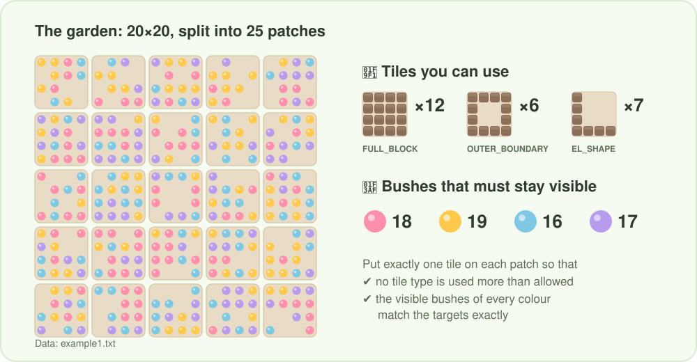
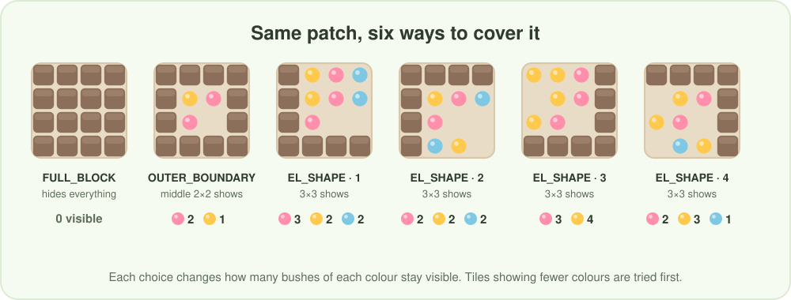
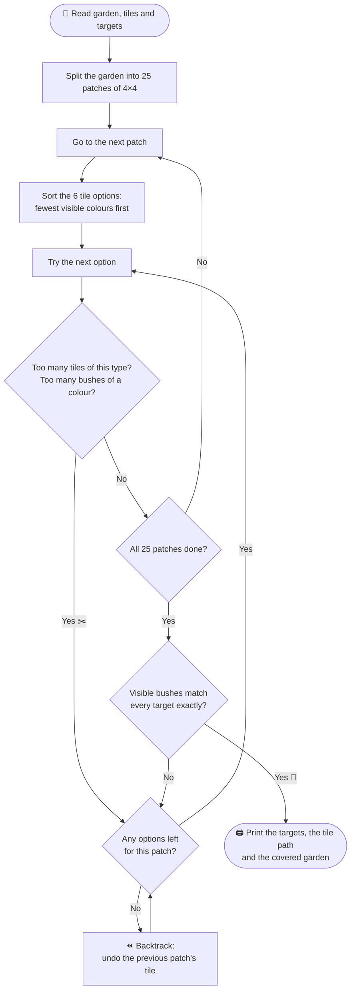
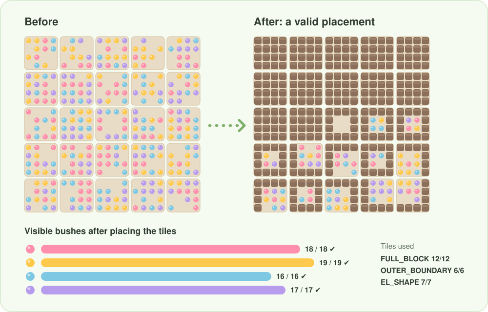

<div align="center">



<br/>


**An AI solver for a tile placement puzzle, framed as a Constraint Satisfaction Problem (CSP).**<br/>
Given a garden full of coloured bushes and a limited set of tiles, it finds where to place each tile so that exactly the right number of bushes of every colour stays visible.

[The puzzle](#-the-puzzle) · [How it works](#-how-it-works) · [Quick start](#-quick-start) · [Example](#-example-run) · [Project structure](#-project-structure)

</div>

---

## 🌷 The puzzle

The landscape is a **20×20 garden**. Each cell is either empty or holds a bush in one of **4 colours**. The garden is split into **25 patches of 4×4**, and every patch must be covered by exactly **one tile**.

<p align="center">
  
</p>

There are three kinds of tiles, and each one hides a different part of the patch:

<p align="center">
  
</p>

| Tile | Covers | Leaves visible |
|---|---|---|
| `FULL_BLOCK` | the whole 4×4 patch | nothing |
| `OUTER_BOUNDARY` | the outer ring | the middle 2×2 |
| `EL_SHAPE` | one row and one column, in 4 orientations | a 3×3 corner |

### The constraints

1. **Every patch gets exactly one tile.**
2. **Limited supply:** each tile type can't be used more times than the input file allows.
3. **Exact targets:** once all tiles are placed, the number of visible bushes of each colour must equal its target. Not one more, not one less.

---

## 🧠 How it works

In CSP terms:

| CSP piece | In this puzzle |
|---|---|
| **Variables** | the 25 patches |
| **Domain** | 6 tile options per patch: `FULL_BLOCK`, `OUTER_BOUNDARY`, and 4 `EL_SHAPE` orientations |
| **Constraints** | tile counts, plus the exact visible-bush targets for each colour |

The solver (`csp_with_MRV` in `CSP.py`) uses **recursive backtracking** with two ideas that keep the search small:

- **Smart ordering:** for each patch, the tile options are sorted by **how many bush colours they leave visible**, so the options that reveal the fewest colours are tried first. This keeps the colour budgets open for later patches.
- **Early pruning:** after every placement it checks the running totals. If a tile type has been used too often, or any colour already has **more** visible bushes than its target, that branch is dropped right away instead of being explored further.



### The result

Here is the solver's placement for `example1.txt`. Every colour target is hit exactly and every tile is used within its limit:

<p align="center">
  
</p>

---

## 🚀 Quick start

**Requirements:** Python 3. Nothing else to install, since the project only uses the standard library.

```bash
git clone https://github.com/fg20-cs/AI_TilePlacement_CSP.git
cd AI_TilePlacement_CSP
python3 Main.py example1.txt
```

Run the tests:

```bash
python3 -m unittest test_CSP.py
```

### Input format

Each input file has three sections: the landscape (bush colours `1`–`4`, with a blank meaning an empty cell), the tile counts, and the target number of visible bushes per colour.

```text
# Landscape
2 2 1 3   3 4   4 2 2 4   4       2 4 3
  2 1 3 2 2       1   1 2 2   2 3 4 4 4
...

# Tiles:
{OUTER_BOUNDARY=6, EL_SHAPE=7, FULL_BLOCK=12}

# Targets:
1:18
2:19
3:16
4:17
```

---

## 🖥️ Example run

The program prints the targets, the tile chosen for each patch (left to right, top to bottom), and then the garden with the covered cells highlighted in green. For `example1.txt` (path wrapped here for readability):

```text
Target: {1: 18, 2: 19, 3: 16, 4: 17}

Final Path:
['Full_block', 'Full_block', 'Full_block', 'Full_block', 'Full_block',
 'Full_block', 'Full_block', 'Full_block', 'Full_block', 'Full_block',
 'Full_block', 'Full_block', 'Outer_block', 'Outer_block', 'Outer_block',
 'Outer_block', 'L_shape_1', 'L_shape_2', 'Outer_block', 'L_shape_4',
 'L_shape_2', 'Outer_block', 'L_shape_4', 'L_shape_1', 'L_shape_3']
```

---

## 📁 Project structure

```text
AI_TilePlacement_CSP/
├── Main.py          # entry point: reads the file, runs the solver, prints the result
├── CSP.py           # the CSP class: parsing, tile functions, constraint checks, search
├── print.py         # prints the covered garden in the terminal
├── test_CSP.py      # unit tests
├── example1-4.txt   # sample gardens
└── assets/          # README graphics
```

| Method in `CSP.py` | Role |
|---|---|
| `extract_data_from_file()` | Parses the landscape, tile counts and targets, and splits the garden into 4×4 patches |
| `Full_block()`, `Outer_block()`, `L_shape_1()` … `L_shape_4()` | Count the bushes of each colour that stay visible under that tile |
| `check()` | Checks the tile limits and the bush targets, and spots the goal |
| `csp_with_MRV()` | The recursive backtracking search |
| `apply_path_to_landscape()` | Applies the found tiles to the garden and recounts the visible bushes |

---

<div align="center">

Made with 🌷 and a lot of tiny tiles

</div>
